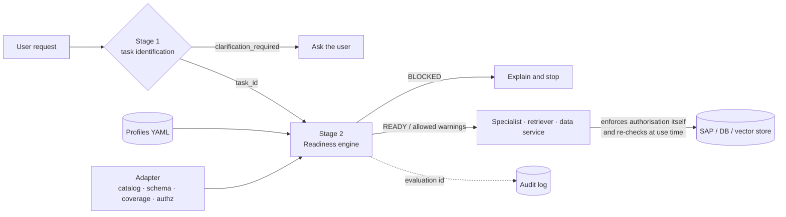

# taskDataReadiness

A small, reusable proof of concept that adds two stages in front of an AI application's data access:

1. **Task identification**: which business task is the user asking for?
2. **Data readiness**: is the data that task needs available, complete enough, current, traceable and
   authorised for this user, this agent and this purpose?

It answers `READY`, `READY_WITH_WARNINGS` or `BLOCKED`, with every check result, plain-language reasons and an
evaluation id that is also written to an audit log.

> **Local demonstration.** Synthetic data, demo permissions and a demo identity selector that is **not
> authentication**. A `READY` result is a *preflight decision*. It does not prove the data is correct, complete for
> every purpose or safe for production, and it does not replace authorisation in the service that returns the data.

First integration target: the SCInsight Supervisor in `~/Supplychain-AI-agent`. The integration findings are in
[docs/supplychain_integration.md](docs/supplychain_integration.md). That repository was inspected but **not modified**.

**Quick start:** `./start.sh dashboard` then open <http://127.0.0.1:8460/dashboard>. The dashboard shows 10 faulty
datasets, which requirements each one fails, proposed fixes (from rules or from Claude), and the re-check after
applying them. See [section 19](#19-faulty-dataset-lab-dashboard-and-claude-agent).

---

## 1. What the project does

```
"Should we move SKU 001 from warehouse A to warehouse C?"
   │
   ├─ Stage 1  POST /tasks/identify   → task_id = warehouse_transfer   (or clarification_required)
   │
   └─ Stage 2  POST /readiness/check  → for each data asset the task needs (inventory, demand forecast, lead times):
                                         access · catalog · freshness · schema · coverage · provenance (· documents)
                                       → READY / READY_WITH_WARNINGS / BLOCKED
```

Only after `READY` (or an allowed `READY_WITH_WARNINGS`) should the calling application invoke its specialist agent,
retriever or data service. That service must still check authorisation itself.

## 2. Why task identification and data readiness are separate stages

* **Different questions.** "What is being asked?" is a language problem; it can be solved by a rule, a form, the
  existing Supervisor or an LLM. "Is the data fit and permitted?" is a deterministic data and policy problem.
* **Different trust.** A task id only *selects a profile*. Knowing (or claiming) that something is a warehouse
  transfer grants no permission. Keeping the stages apart stops a classifier's output from ever acting as an
  authorisation.
* **Reuse.** The existing Supervisor already classifies requests. The readiness engine accepts its answer instead of
  adding a second LLM call (`from_supervisor_intent` in [app/task_router.py](app/task_router.py)).
* **Failure handling.** An ambiguous request stops at Stage 1 (`clarification_required`). It is never mapped to a
  weaker profile.

## 3. Vocabulary

| Term | In this project | Example |
| --- | --- | --- |
| **Catalog** | Facts about each data asset: owner, source, version, timestamps, schema, coverage. | [catalog/demo_catalog.yaml](catalog/demo_catalog.yaml) |
| **Contract** | An agreement with the data producer on schema, freshness and quality. Only a *reference* (`contract_ref`) is recorded here; no contract engine exists. | `contracts/inventory_snapshot@1.2` (demo text) |
| **Profile** | What one *task* needs: required context, assets, thresholds, block/warn choices. Versioned and validated on load. | [profiles/warehouse_transfer.yaml](profiles/warehouse_transfer.yaml) |
| **Adapter** | The plug that answers the engine's questions about a real or demo system (catalog, schema, coverage, authorisation). | [app/adapters/demo.py](app/adapters/demo.py) |
| **Readiness check** | One deterministic test (freshness, schema, ...) that returns PASS / WARN / FAIL / ERROR. | [app/checks/](app/checks/) |
| **Access-control enforcement** | The data service refusing to return rows or documents the caller may not see. **Not done by this project**; it must happen in SAP, the database, the API or the vector store. | PostgreSQL row-level security, the SCInsight API key check |

## 4. Why an LLM is optional, and how it works with AI switched off

The readiness engine contains no model and makes no network calls of its own. Every decision comes from YAML
configuration and adapter evidence, so the same input always gives the same answer.

The task id can come from:

1. a trusted application that already knows the task (`"task_id": "warehouse_transfer"`);
2. the existing Supervisor's classification (no extra LLM call);
3. the transparent demo keyword router (no LLM).

With AI switched off, a user interface can offer a task picker and call `/readiness/check` directly. Nothing in
Stage 2 changes.

## 5. Architecture



### Why the readiness check sits before RAG retrieval, and why it is not enough on its own

* **Before retrieval (this project):** stop early and explain when there are no approved, valid documents the caller
  may use, or when the caller lacks permission. Nothing is retrieved for a request that cannot succeed.
* **Before indexing (ingestion, not built here):** record each document's source id, version, classification,
  approval state and access metadata. Without that metadata, no later step can filter correctly.
* **During retrieval (the retriever's job):** filter by permission *inside* the vector-store query, so unauthorised
  chunks are never loaded. The demo version is `DemoProtectedPolicyRetriever` in [app/protected.py](app/protected.py).
* **After retrieval:** check that the *authorised* passages actually answer the question
  (`post_retrieval_evidence_check`). A preflight `READY` says nothing about whether an answer exists. The scenario
  `policy_search_no_evidence` shows a `READY` preflight with `answerable: false`.

For structured data, row and column restrictions belong in the database or protected service. One example is
PostgreSQL row-level security on `warehouse_id`; another is the SCInsight API deriving the tenant from the API key.

Data can change between the check and its use, a time-of-check/time-of-use gap. `protected.guarded_call()`
re-evaluates immediately before the protected call. The consuming service must still enforce its own rules. Details
are in [docs/architecture.md](docs/architecture.md).

## 6. Project structure

```
taskDataReadiness/
├── README.md                     this file
├── pyproject.toml                dependencies + pytest/ruff config
├── .env.example                  settings (no secrets)
├── start.sh                      launcher: setup, API, dashboard, demo, tests, status/stop (see section 9)
├── app/
│   ├── main.py                   FastAPI routes, structured errors, demo/integration mode
│   ├── models.py                 request/response shapes (extra fields forbidden)
│   ├── task_router.py            Stage 1: explicit id, Supervisor intent, demo keyword router
│   ├── engine.py                 Stage 2: runs checks, decides READY / READY_WITH_WARNINGS / BLOCKED
│   ├── profiles.py               profile schema + validation on load
│   ├── catalog.py                catalog schema (owner, versions, timestamps, coverage, access policy)
│   ├── identity.py               demo identity selector; trusted-provider interface (not implemented)
│   ├── audit.py                  audit records (pseudonymous user ref, no prompts or raw data)
│   ├── protected.py              use-time recheck + demo protected retriever + post-retrieval check
│   ├── scenario_runner.py        runs the labelled scenarios
│   ├── settings.py               environment settings, injectable clock
│   ├── remediation.py            fix planner (rules), allow-list, applier (source of record / registry / lossless)
│   ├── claude_agent.py           optional Claude agent: diagnoses and proposes fixes (never applies, never decides)
│   ├── dataset_lab.py            faulty-dataset lab: check, propose, apply, reset, auto-correct
│   ├── dataset_routes.py         /demo/datasets/... and /dashboard routes
│   ├── static/dashboard.html     the visual dashboard (no external scripts)
│   ├── checks/                   access · freshness · schema · coverage · quality · provenance · documents · context
│   └── adapters/                 base.py (interface) · demo.py (synthetic catalog) · dataset.py (CSV files)
├── datasets/                     source_of_record/ · steward_registry.yaml · profiles/ · cases/00..10 · build_datasets.py
├── profiles/                     warehouse_transfer.yaml · policy_document_qa.yaml
├── catalog/                      demo_catalog.yaml · demo_identities.yaml · demo_scenarios.yaml
├── examples/                     sample_requests.json (36 labelled scenarios) · flowise_integration.md
├── integrations/supplychain/     patched-copy generator for the SCInsight Supervisor, gate JS, Node harness
├── scripts/run_demo.py           run every scenario, print expected vs actual + latency
├── scripts/run_dataset_demo.py   detect → correct → re-check the 10 faulty datasets in the terminal
├── tests/                        router · readiness · API · SCInsight integration · datasets · Claude agent (stub)
└── docs/                         architecture.md · supplychain_integration.md · evaluation.md
```

## 7. Requirements

* Linux or WSL2 with Python 3.11+ (verified with 3.12.3).
* Node.js 18+ only for the Flowise gate tests (verified with 24.22.1). Those tests are skipped if `node` is missing.
* No database, no paid model, no cloud account, no SAP system and no external API.

Dependency ranges are in [pyproject.toml](pyproject.toml). Verified versions: fastapi 0.162.7, uvicorn 0.54.0,
pydantic 2.14.3, PyYAML 6.0.3, httpx 0.28.1, pytest 9.2.0, ruff 0.17.5.

## 8. Setup (Linux / WSL)

```bash
cd ~/DataReady
python3 -m venv .venv
.venv/bin/pip install --upgrade pip
.venv/bin/pip install -e '.[dev]'
cp .env.example .env          # optional; the defaults are the same
```

## 9. Run the API

`start.sh` is the launcher. It creates `.venv` and installs dependencies on first use, loads `.env`, and binds
127.0.0.1 only.

```bash
./start.sh              # foreground on http://127.0.0.1:8460  (Ctrl+C to stop)
./start.sh --bg         # background; log in .data/server.log, PID in .data/server.pid
./start.sh dashboard    # background + print the dashboard URL
./start.sh demo         # faulty-dataset demo in the terminal (all 11 cases); ./start.sh demo 07 for one case
./start.sh scenarios    # the 36 labelled readiness scenarios
./start.sh test         # pytest + ruff
./start.sh status       # is it running? (by port)
./start.sh stop         # stops the server it started (by port + PID file, never by process name)
./start.sh restart | setup | help
```

OpenAPI docs: <http://127.0.0.1:8460/docs>.

The demo clock is fixed at `2026-11-14T08:00:00+00:00` (`TDR_CLOCK`), so the synthetic data is "fresh" and the
examples below are reproducible. With `TDR_CLOCK=system` the same data becomes stale and checks block, as they
should.

## 10. Run the tests and static checks

```bash
.venv/bin/python -m pytest          # 152 tests
.venv/bin/python scripts/evaluate.py   # labelled evaluation -> docs/evaluation_report.md
.venv/bin/ruff check .              # lint
.venv/bin/ruff format --check .     # formatting
```

## 11. Calling each endpoint with curl

Outputs below are copied from a run on 2026-11-14 (ids and latency differ per run).

```bash
B=http://127.0.0.1:8460
curl -s $B/health
# {"status":"ok","mode":"demo","demo_mode":true,"adapter_mode":"demo",
#  "authentication":"demo_selector: ... This is NOT authentication ...","profiles":{"policy_document_qa":"1.0.0","warehouse_transfer":"1.0.0"},...}

curl -s -X POST $B/tasks/identify -H 'Content-Type: application/json' \
  -d '{"question":"Should we move SKU 001 from warehouse A to warehouse C?"}'
# {"task_id":"warehouse_transfer","status":"identified","method":"demo_keyword_rules",
#  "suggested_context":{"product_id":"SKU-001","origin_warehouse":"WH-A","destination_warehouse":"WH-C"},...}

curl -s -X POST $B/tasks/identify -H 'Content-Type: application/json' \
  -d '{"question":"What does the policy say about how to move stock between warehouses?"}'
# {"task_id":"unknown","status":"clarification_required", "explanation":"The question matches more than one task ..."}
```

Readiness check: `READY`

```bash
curl -s -X POST $B/readiness/check -H 'Content-Type: application/json' -d '{
  "task_id": "warehouse_transfer",
  "context": {"product_id":"SKU-001","origin_warehouse":"WH-A","destination_warehouse":"WH-C",
              "planning_period":"2026-11-16/2026-11-29"},
  "demo_identity": {"user":"planner_all","agent":"scinsight_supervisor"}}'
# "decision":"READY", "evidence_refs":["sap_inventory_snapshot@SAP-SYN-2026-11-14","demand_forecast_weekly@FCST-2026-W46",
#  "transfer_lead_times@LANES-2026-11"], "authenticated":false, "identity_mode":"demo_selector", "checks":[...]
```

Readiness check: `BLOCKED`. Use the same body plus `"demo_scenario":"stale_inventory"`, or swap the user to
`planner_ab`:

```
"decision":"BLOCKED","reasons":["inventory: Source data is 74.0 h old; the profile allows at most 24 h. It was
ingested 0.5 h ago, but a recent ingestion does not make old source data fresh."]

"decision":"BLOCKED","reasons":["inventory: Access denied for the user: the user is not permitted to see data for: WH-C.", ...]
```

Errors share one shape. On gated paths they also say `"decision":"BLOCKED"`:

```bash
curl -s -X POST $B/readiness/check -H 'Content-Type: application/json' -d '{"task_id":"price_optimisation"}'
# 404 {"error":{"code":"unknown_task_profile","message":"No readiness profile for task 'price_optimisation'. ...",
#      "details":["policy_document_qa","warehouse_transfer"]},"decision":"BLOCKED","evaluation_id":"tdr-..."}

curl -s -X POST $B/readiness/check -H 'Content-Type: application/json' -d '{"task_id":"warehouse_transfer","user_id":"admin"}'
# 422 {"error":{"code":"invalid_request","message":"The request body is invalid.",
#      "details":[{"loc":["body","user_id"],"msg":"Extra inputs are not permitted","type":"extra_forbidden"}]},"decision":"BLOCKED"}
```

Both stages in one call (demo convenience). `context_sources` shows which values came from the router's guess:

```bash
curl -s -X POST $B/evaluate -H 'Content-Type: application/json' -d '{
  "question":"Should we move SKU 001 from warehouse A to warehouse C?",
  "context":{"planning_period":"2026-11-16/2026-11-29"},
  "demo_identity":{"user":"planner_all","agent":"scinsight_supervisor"}}'
# "decision":"READY","context_sources":{"product_id":"router_suggestion",...,"planning_period":"request"}
```

Policy question through the demo protected retriever (use-time recheck, then retrieval, then post-retrieval check):

```bash
curl -s -X POST $B/demo/policy/search -H 'Content-Type: application/json' -d '{
  "question":"What does the supplier policy say about returns?",
  "demo_identity":{"user":"planner_all","agent":"scinsight_supervisor"}}'
# "decision":"READY","retriever_called":true,"answerable":true,
# "retrieval":{"hits":[{"doc_id":"POL-RET-001","version":"2.1",...}],"filtered_out":3,...}
# The revoked v1.0, the draft and the restricted finance document are filtered out and not named.
```

Other endpoint: `GET /profiles` lists task ids, versions and requirements.

## 12. Running the demo scenarios

```bash
.venv/bin/python scripts/run_demo.py                                  # in-process, no server needed
.venv/bin/python scripts/run_demo.py --base-url http://127.0.0.1:8460 --repeat 20   # live server + latency
```

It prints expected against actual for the 36 labelled scenarios in
[examples/sample_requests.json](examples/sample_requests.json). The scenarios cover: READY; stale inventory;
ingestion time without source time; missing Warehouse C; a user not scoped to WH-C; lead times unavailable; a
missing lane; authorisation unavailable; catalog unavailable; no identity; untrusted or missing agent; wrong role;
missing context; unknown product; uncovered period; missing schema field; provenance block vs. warn; an aging
forecast (warning); unknown task; identity sent in the body; and policy preflight with the protected retriever.
Demo scenario patches are defined in [catalog/demo_scenarios.yaml](catalog/demo_scenarios.yaml).

## 13. How to add another task profile

1. Copy a file in `profiles/`, for example `profiles/replenishment_order.yaml`.
2. Set `task_id`, `version` (`MAJOR.MINOR.PATCH`), `purpose` and `demo_values_note`.
3. List `required_context` fields, each with a regex `pattern`.
4. List the `assets` with `mandatory`, `access`, and any of `freshness`, `schema`, `coverage`, `provenance` and
   `documents`. Choose `block` or `warn` where offered, and decide `allow_warnings`.
5. Register each `asset_id` in the catalog (or in your real adapter).
6. Optional: add router rules in `RULES` ([app/task_router.py](app/task_router.py)) and a Supervisor intent mapping
   in `SUPERVISOR_INTENT_TO_TASK`.
7. Restart. An invalid profile stops the service with a clear message, so a typo cannot silently weaken a check.
8. Add labelled scenarios to `examples/sample_requests.json` and run the tests.

## 14. How to connect a new data adapter

Subclass `ReadinessAdapter` ([app/adapters/base.py](app/adapters/base.py)) and implement `get_asset()` and
`authorize()`. Override `get_schema()`, `get_coverage()`, `get_timestamps()` and `get_documents()` when the real
system can answer them more directly. Set `mode = "real"` only if it really talks to the system of record. Raise
`AdapterUnavailable` when a system does not answer, and return `allowed=None` when permission is unknown. The engine
blocks in both cases.

| Target | How a future adapter could answer |
| --- | --- |
| PostgreSQL | `information_schema.columns` for schema; `SELECT DISTINCT warehouse_id ... WHERE product_id = $1` for coverage; a snapshot table for event and ingestion times. Run as the *user's* database role so row-level security applies. |
| Existing SAP integration (SCInsight) | `GET /scinsight/api/v1/context` (snapshot id, as-of, synthetic flag), `/sap/warehouses`, `/sap/inventory?item_id=` for coverage, `/rag/documents` for document metadata, all called with the caller's own key. Not implemented: no verified per-user identity reaches it today. |
| OpenMetadata or another catalog | Table entity: owners, tags or classification, schema, `updatedAt`; lineage for source names; data-quality test results as `contract_status()`. |
| Identity / authorisation service | `authorize()` calls OPA, Cedar or your IAM with user, agent, purpose and row scope. Principals come from a `TrustedIdentityProvider` that validates tokens (see [app/identity.py](app/identity.py)). |

## 15. How Flowise can call the service

A Flowise Custom Function node (code, not a prompt) calls `POST /readiness/check`. A Condition node then routes
`READY` to the specialist and everything else to a Direct Reply. For the SCInsight Supervisor this repository
generates a patched **copy** of the exported flow and tests the gate's JavaScript with Node against this API. The
copy has **not been imported into Flowise**. Steps, variables and the exact request are in
[examples/flowise_integration.md](examples/flowise_integration.md).

## 16. Security limitations of demo mode

* **No authentication.** `demo_identity` is a name anyone can send. Results carry `authenticated: false` and
  `identity_mode: demo_selector`. Adding an API key would not make the demo secure: the user identity would still be
  self-asserted.
* **Demo permissions only.** The DemoAdapter does not enforce production ACLs. It answers the engine's questions
  from YAML.
* **Preflight, not enforcement.** Nothing stops a caller from skipping this service and calling the data source
  directly. Only the data service's own checks can.
* **Bound to `127.0.0.1`** by `start.sh`. Do not expose it on a network.
* `TDR_MODE=integration` refuses the demo selector and demo scenarios. Because no trusted identity provider is
  implemented, every check then returns `BLOCKED`.

## 17. Implemented, simulated, not implemented

| Area | Status |
| --- | --- |
| Stage 1: explicit task id, Supervisor-intent mapping, demo keyword router, clarification | **Implemented** |
| Stage 2 engine: decision rules, mandatory vs. optional, warnings policy, fail closed | **Implemented** |
| Checks: context, access (user + agent + purpose + warehouse row scope), freshness (event vs. ingestion time), schema, coverage, provenance, documents | **Implemented** (against demo evidence) |
| Profile and catalog validation on load | **Implemented** |
| Audit records (JSON lines, pseudonymous user) | **Implemented** (no retention, no tamper evidence) |
| FastAPI endpoints, OpenAPI docs, structured errors | **Implemented** |
| Use-time recheck (`guarded_call`), post-retrieval evidence check | **Implemented** (demo) |
| Catalog, identities, permissions, data timestamps, coverage | **Simulated** (synthetic YAML) |
| Protected retriever | **Simulated** (keyword scoring over demo documents) |
| SCInsight Supervisor gate | **Generated copy + Node-tested gate code**; not imported into Flowise, not run in Flowise |
| Real authentication / trusted identity provider | **Not implemented** (interface only; integration mode fails closed) |
| Real SAP, PostgreSQL, OpenMetadata or IAM adapters | **Not implemented** |
| Production audit (retention, integrity, access control) | **Not implemented** |
| Faulty-dataset lab: 10 faults detected from real CSV files, rule-based fixes, re-check, dashboard | **Implemented** (synthetic files) |
| Claude agent proposing fixes | **Implemented, tested with a stub client only.** No Anthropic credential exists on this machine, so no real Claude call has been made |

## 18. Next steps toward production

1. Propagate a verified user identity through Flowise and LangGraph (for example token exchange, so the agent acts
   *on behalf of* the user). Today SCInsight flows use one shared agent key.
2. Implement a `TrustedIdentityProvider` (OIDC/JWT validation, mTLS for agents) and a real policy decision point.
3. Write an SCInsight adapter that reads snapshot, coverage and document metadata with the caller's credentials.
4. Enforce row scope where the data lives (SCInsight has no per-warehouse user scope today).
5. Put the gate into `flowise/scinsight/build-scinsight.cjs` and the LangGraph `route()` instead of a hand-patched
   export. Then cover the direct paths listed in [docs/supplychain_integration.md](docs/supplychain_integration.md).
6. Production audit: append-only store, retention rules, correlation with downstream logs.
7. Agree real thresholds with data owners; version profiles through change review.

## 19. Faulty-dataset lab, dashboard and Claude agent

**What it shows:** the engine finding a fault in real data files, a fix being proposed, the fix being applied to a
copy, and the engine re-checking that copy. Task: `warehouse_transfer` for SKU-001 from WH-A to WH-C, 2026-11-16 to
2026-11-29.

```bash
./start.sh dashboard            # then open http://127.0.0.1:8460/dashboard
./start.sh demo                 # same lab in the terminal
```

**The 11 cases** (`datasets/cases/`, generated by `datasets/build_datasets.py`; all synthetic):

| Case | Injected fault | Detected by | Fix | Data for the fix comes from |
| --- | --- | --- | --- | --- |
| 00 clean | none (control) | - | - | - |
| 01 | inventory snapshot 3 days old, re-ingested today | freshness | refresh_from_source | source of record |
| 02 | WH-C rows missing | coverage | reextract_rows (WH-C) | source of record |
| 03 | `expiry_date` column dropped | schema, quality | restore_columns | source of record (join on key) |
| 04 | duplicate batch rows (one exact, one conflicting) | quality (unique key) | deduplicate | lossless + source of record |
| 05 | negative quantities | quality (non-negative) | replace_bad_rows_from_source | source of record |
| 06 | empty status / quantity | quality (not null) | replace_bad_rows_from_source | source of record |
| 07 | status `Released`, ` released `, `ok` | quality (allowed codes) | normalise_codes + replace | lossless + source of record |
| 08 | expiry dates as DD/MM/YYYY | quality (ISO dates) | reformat_dates | lossless, using the format the export declares |
| 09 | lead time WH-A>WH-C missing | coverage (lane) | reextract_rows (lane) | source of record |
| 10 | inventory owners not recorded | provenance | lookup_owner | steward registry |

`fault.yaml` in each case describes the fault for people and tests. The engine never reads it: it finds each fault
from the CSV files (header = schema, distinct values = coverage, rows = quality) and `manifest.yaml` (owners,
versions, source event time). Quality is checked only on the rows the task uses.

**Correction rules:**

* Fixes never invent values. Each fix comes from the source of record (`datasets/source_of_record/`), the steward
  registry (`datasets/steward_registry.yaml`), or a lossless transform. A row that cannot be repaired goes to
  `quarantine/` rather than being guessed.
* Fixes are applied to a **working copy** (`.data/datasets/<case>/`). The original faulty files are never changed.
  The working copy's manifest records a `remediation_log`, marks the version `+remediated`, and notes where filled
  owners came from.
* Problems that data changes cannot fix (access denied, missing task context, unavailable services) become
  "needs a person" items. Switch the dashboard identity to `planner_ab` (no access to WH-C) to see this.
* Every proposal, from the rules, from Claude or from the browser, is validated against the same allow-list on the
  server before anything runs. Only the readiness engine decides READY.

**Dashboard:** case list (original → working copy decision), a requirement × check grid for both copies (click a
cell for the reasons), proposed fixes with what each one does and where its data comes from, *Apply selected*,
*Reset working copy*, and *Auto-correct all cases*.

**Claude agent (optional):** *Ask Claude* runs `claude-opus-5-5` through the Anthropic SDK tool runner. It uses
adaptive thinking and server-side refusal fallback (`fallbacks: "default"`), so if the model declines, the server
retries with a fallback model. Claude gets read-only tools (`get_failures`, `inspect_rows`, `list_actions`) and one
`propose_fix` tool. It explains the problem in plain language and proposes fixes. It cannot apply them, and it
cannot mark data as ready.

To enable it, put `ANTHROPIC_API_KEY=...` in `.env` (git-ignored), or run `ant auth login`, then
`./start.sh restart`. Each click is a paid API call, and it sends the failing checks plus a few synthetic sample
rows to Anthropic. Without credentials the button is disabled and the rules planner still works.

Dataset lab endpoints (demo mode only): `GET /demo/datasets`, `POST /demo/datasets/{case}/check | propose | apply |
reset | auto-correct`, `POST /demo/datasets/run-all`.

## 20. Data Harness in Flowise (SAP pipeline, roles, metrics)

> "Before an AI agent performs a supply-chain task, the Data Harness checks whether the required data is available,
> current, reliable, traceable and authorized for that user, agent and purpose."

```bash
./start.sh flowise     # API + dedicated Flowise on http://127.0.0.1:3460 with the Data-Readiness-Agentflow-v1
```

Log in with `admin@tdr.local` (password `TDR_FLOWISE_ADMIN_PASSWORD` in `.env`), open the Agentflow, click the
chat icon, and fill in the form: **AI task**, **role**, **faults**. `./start.sh flowise-stop` stops the container.
This Flowise is separate from every other Flowise on the machine. It binds 127.0.0.1 only and uses host networking
to call the API.

**The four components.** All data is synthetic, and the SAP systems are simulated (CSV files), never connected.

| Component | Where | What is in it |
|---|---|---|
| Data catalog | `pipeline/catalog.yaml` | Every field in sections A–D: identity and ownership (owner, steward, technical owner, contact, lifecycle, review date), source and history (system, location, record id, transformation, lineage, change history), meaning and coverage (definitions, types, units, granularity, geography, limitations, approved use), security (classification, permitted users, agents, purposes, retention), plus document authority and RAG index version for documents. Version, event time and ingestion time come from the extraction. Coverage, completeness and quality history are computed. |
| Data contracts | `pipeline/contracts.yaml` | One per asset, ODCS-inspired (not a validated ODCS file). It covers identity and version, producer and consumer, purpose, ownership, source rules, schema and unique key, business definitions, quality rules (allowed units, codes), freshness, coverage, security, lineage, operational expectations, change management, evidence, and human approval. |
| Data Harness Profiles | `pipeline/tasks.yaml` | 13 versioned, approved task readiness profiles, one per task (section 21). Each names its agent, output, required assets, task overrides (inventory ≤ 2 h for transfers, 48 h for the report), row and column ACL, optional assets, the safe partial output, and actions. |
| Readiness gate | `app/pipeline.py` + `app/engine.py` | It checks profile → catalog → access → freshness → coverage (plus required fields, quality, provenance, catalog/contract completeness) → decision, and returns the answer, the table, the evidence and an evaluation id. |

**ACL levels:** user and agent (catalog `permitted_agents`), dataset or document (role `read`), row (role
`warehouses`, for example `harness:planner` covers WH-A and WH-B only), column (role `columns`, supplier `price_eur`),
purpose (catalog `permitted_purposes`), and action (profile `actions`: recommend after checks; execute needs a human).
The engine checks the user and the agent separately, so an agent cannot use its broader access to show a user data
that user may not see. Data sets the user cannot read are shown as "Restricted data set", without their name.
This is demo authorization. Real enforcement belongs in the database, API or retriever.

**The round loop:** 1 Detect → 2 Propose (mock agent, no LLM) → Human approval → 3 Fix (only the fixes the role
may approve) → re-check. Each approved fix is recorded as a simulated upstream rule, so the next round extracts
without that fault.

**Metrics and evaluation:**

* Every evaluation records its id, task and profile version, timestamp, decision, each check's result, duration
  and safe reason, evidence refs, adapter mode and total latency. These go to the audit log and to
  `GET /pipeline/metrics`. Question text, prompts and raw rows are never recorded.
* Per-asset data metrics (shown only where evidence exists): source data age, ingestion delay, required-field
  completeness, task coverage, schema compliance, contract validation, provenance completeness, and catalog/contract
  completeness. `GET /pipeline/catalog/{asset}` shows the full record, the contract and the quality-check history.
* `./start.sh` → `.venv/bin/python scripts/evaluate.py` runs 77 labelled scenarios and writes
  [docs/evaluation_report.md](docs/evaluation_report.md). It reports unsafe passes, false blocks, block detection,
  exposure and bypass results, check errors, unknown results, P50/P95 latency and the most common block reasons,
  each with its denominator.

## 21. Data Readiness Table: Role → Task → Profile (main UI)

Open **http://127.0.0.1:8460/dashboard** (also served at `/` and `/table`) after `./start.sh`.

```
1 User role → 2 Requested task → 3 Authorized data → 4 Data readiness profile → 5 Data set
  → 6 Readiness checks → 7 Propose fixes → 8 Apply fixes → READY: retrieve authorized data and run the task
```

The header line, the control row and the section numbers on the page use the same eight steps.

| Stage | On the page | Where it comes from |
|---|---|---|
| 1 User identity and role | Role dropdown, with all 28 roles grouped by app | `pipeline/roles.yaml`. This is a demo selector, not authentication. |
| 2 Requested task | Task dropdown: only the tasks this role may request | `tasks:` per role in `roles.yaml` |
| 3 Authorized data | ALLOWED vs REQUIRED: user authorized, agent authorized and allowed for this task (hover shows the reason), plus who approves fixes and the data owner | Data-set, row (warehouse), column (`price_eur`) and purpose ACL. User and agent are checked separately. |
| 4 Data readiness profile | Profile id, version, approver, agent, output and the rules per required data set | `pipeline/tasks.yaml` (one profile per task) |
| 5 Data set | A neutral SAP extract (`DS-01` … `DS-17`). It does **not** reveal whether it is clean or faulty: the checks have to find out | `GET /pipeline/datasets`, `POST /pipeline/extract {"dataset": "DS-07"}` |
| 6 Readiness checks | What is missing, then per data set every AI-readiness metric (owner, SAP source, refresh time, coverage, units, user/agent authorization, quality checks, catalog A–D and contract), with current value, status and recommended fix | `PipelineService.checklist()` on top of the deterministic engine |
| 7 Propose fixes | The **correction agent** (Mock or Claude) lists each missing metric with its fix, its data origin and its approver | `POST /pipeline/propose` |
| 8 Apply fixes | **Approve & apply**: only the fixes this role may approve; then it re-checks | `POST /pipeline/apply` |
| READY | Re-checks at use time, then retrieves only the rows and columns the user may see, then runs the specialist (stock comparison or transfer recommendation; other tasks state what would run) | `POST /pipeline/retrieve` |

The same role gets different profiles for different tasks. For example, the warehouse manager has Compare stock
(inventory ≤ 24 h only), Recommend a stock transfer (inventory ≤ 2 h + forecast + lanes) and Read the transfer
policy (approved documents). The engine never falls back to a weaker profile when ALLOWED < REQUIRED. Some roles
are therefore BLOCKED even on clean data, which is intended. Examples: `harness:planner` (no WH-C rows),
`aurelia:demand` (no MDG read right), `scinsight:planner` for replenishment (no supplier price column),
`sap_executor` and the harness admin/auditor roles (no data read rights).

**Correction agent: mock first, Claude later.** The page offers:

* **Mock agent** (default): deterministic, no LLM, no cost. All stages above are tested with it.
* **Claude agent** (`claude-opus-5-5`, `app/claude_agent.py`): it uses the same allow-list and the same proposal
  table, and a human still approves. It is shown as *not configured* until a credential exists. To use your
  Claude account, put `ANTHROPIC_API_KEY=...` in `.env` (or run `ant auth login`), then run `./start.sh restart`.
  The wiring is tested with a stub client only. Real model behaviour has not been run on this machine. Each
  propose call is a paid API request.

The readiness engine is one barrier, not the only one: the database, API and retriever must enforce the same
access rules in a real deployment.

## 22. Production-style building blocks (all local, `pip install`, no Docker, no paid calls)

| Need | What is implemented | Where |
|---|---|---|
| **One catalog, contracts in ODCS** | One **ODCS v3.1.0** file per data asset holds the catalog record *and* the data contract. This is the single source of truth, and the engine reads it through the `OdcsCatalog` adapter. Each file is validated against the **official ODCS JSON Schema** at load time; the checklist shows "Is the contract a valid ODCS file in the catalog?". Columns, types, required (not null), primary keys, business definitions, quality rules (allowed values, non-negative, ISO dates), freshness (SLA `latency`), retention, owners (`team`), contact (`support`) and permitted users and agents (`roles`) use native ODCS fields. Other catalog fields sit in ODCS `customProperties`. | `pipeline/odcs/*.odcs.yaml`, `app/odcs.py`, `GET /pipeline/odcs/{asset}` |
| **OpenLineage** | Every run emits standard OpenLineage events (START + COMPLETE) to a JSON-lines file: `sap_extract` (source → staging, with version and row-count facets), `readiness_gate.<task>` (one data-quality assertion per check), `apply_fixes` (inputs = where corrected data came from: SAP source of record or steward registry), `rag_index_build`, `retrieve.<task>` (staging + index → agent context). The checklist row "Are lineage, transformations and changes recorded?" shows the recorded runs. | `app/lineage.py`, `.data/pipeline/lineage/openlineage.jsonl`, `GET /pipeline/lineage?asset=s4_mm_stock` |
| **Permission-aware retrieval** | **Chroma** (embedded) indexes the policy and agreement texts, one chunk per section, using the free local model all-MiniLM-L6-v2 (downloaded once, ~80 MB). The **filter runs inside the vector query**: only (1) documents approved and valid today in the SAP Ariba register and (2) documents whose groups include the role are candidates. Superseded or expired versions and documents outside your groups are never returned, to the agent or the user. Policy tasks show cited passages; READY policy tasks also get a free-text search box. | `app/rag.py`, `pipeline/documents/*.md` + `acl.yaml`, `POST /pipeline/search` |

**Simplifications to replace in production:**
* The ODCS files live in git. A catalog product (OpenMetadata, DataHub, or your company's catalog) would store
  them, and the `OdcsCatalog` adapter would read its API instead.
* Lineage goes to a file. Switching to an HTTP transport sends the same events to Marquez, OpenMetadata or DataHub.
* Document groups are simulated in `acl.yaml`. A real deployment syncs them from the DMS or SharePoint.
* Chroma becomes pgvector or a managed vector store.
* Tests use a deterministic offline hashing embedding (`TDR_RAG_EMBEDDING=hashing`), so they never download the model.
* Chroma telemetry is switched off.

**Certified data, RAG ingestion and approval requests:**
* **Publish on READY.** When a check is READY, every data set that passed all its checks is saved as an immutable
  version: `.data/pipeline/published/<asset>/v<N>/` (CSV + `manifest.json` with evaluation id, tasks certified for,
  ODCS contract, the fixes that really changed data, hash). `current.json` points to the live version. Identical
  content is never published twice. BLOCKED or warning-only data is never published. `GET /pipeline/published`.
* **RAG ingestion.** Each new version is ingested into Chroma, one chunk per row. Restricted columns (e.g. `price_eur`)
  are never indexed. Step 6 retrieval reads the certified version, and "Ask the certified data"
  (`POST /pipeline/search-data`) searches only the task's authorized data sets, on the task's warehouses, limited
  further by the role's row access.
* **Request approval.** After Apply, a "What's next" box names who must act. Fixes the role may not approve are sent
  with **Request approval** (`POST /pipeline/request-approval`). The approver sees them under "Approval requests for
  you" (`GET /pipeline/requests?role=`) and approves or rejects them (`POST /pipeline/requests/{id}/decide`). On
  approval the fixes are applied and the requester's task is re-checked. If it is READY, the data is published.

**Inside SPARC (`~/Supplychain-AI-agent`):** sidebar **AI / RAG → Data Readiness**. SPARC's gateway serves this page at
`/data-readiness/dashboard?embed=1&role=aurelia:<role>` and forwards `/data-readiness/pipeline/*` to this engine
(`DATA_READINESS_URL`, default `http://host.docker.internal:8460` through the `readiness-relay` socat service, which
binds the Docker bridge only). API calls need a SPARC key and are audited. The role follows SPARC's "Acting as",
and the theme follows SPARC. Keep this engine running (`./start.sh --bg`), or the page shows "engine unreachable".

**Migration:** `.venv/bin/python scripts/export_odcs.py` converted `catalog.yaml` + `contracts.yaml` (now marked
legacy) into the ODCS files. It proved each file is schema-valid and that the round trip is lossless.
`scripts/export_odcs.py --check` re-validates the files after you edit them.
